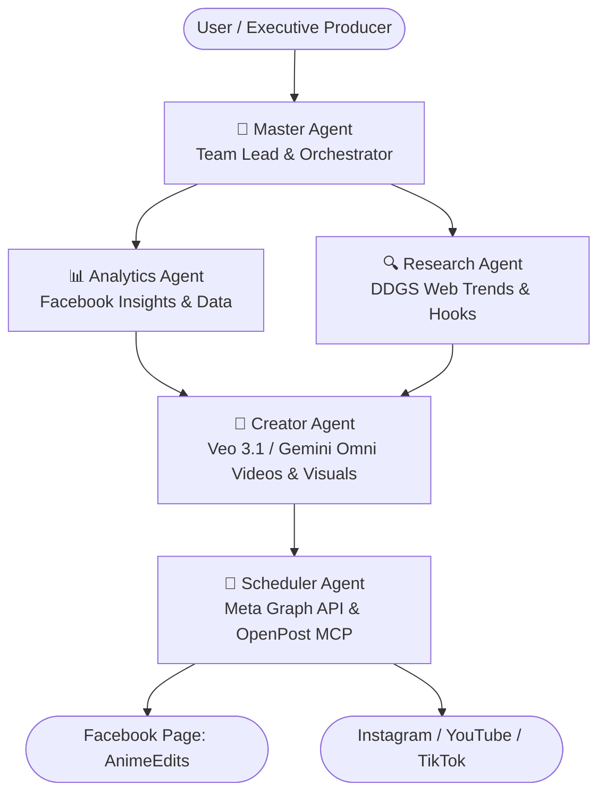

# 🚀 Socialix AI Studio — Agent Architecture & Operating Manual

> **Mandatory Reference for all Coding Agents (Antigravity, Cursor, Windsurf, Claude Code, etc.)**  
> Read this document in full before editing or extending the codebase. It details system architecture, agent orchestration, video generation pipelines, connected channels, OpenPost MCP monitoring, and critical operational guardrails.

---

## 1. Project Overview & Channel Identity

**Socialix** is an autonomous 5-Agent AI Content Studio and growth engine purpose-built for high-retention serialized anime reels, manhwa adaptations, and viral social media campaigns.

### 🌐 Connected Channels & Real Identifiers
* **Facebook Page**: `AnimeEdits` (Page ID: `1316616991525561`) — Connected via Meta Graph API v25.0 with 63+ real published reels and over 1,000,000+ views.
* **YouTube**: `@strawhat-b2j` (`https://youtube.com/@strawhat-b2j`) — YouTube Shorts & community series.
* **Instagram**: `@naruto.uzumaki8067` — High-impact 9:16 visual carousels and Reels.
* **TikTok**: 9:16 vertical edits with phonk audio and fast-paced hook editing.

### 🎬 Core Series & Creative Storylines
1. **Flagship Series: *An Intelligent Blind Gangster***
   - **Premise**: The protagonist was **NOT** born blind. He was an elite underworld mastermind betrayed and blinded in a cartel ambush by his own syndicate brothers.
   - **The Twist**: Losing his sight did not weaken him—it amplified his tactical genius, hearing, and shadow network. He operates from the dark, outplaying rival bosses and corrupt detectives who mistakenly treat him as helpless.
   - **Visual Style**: Dark psychological crime noir (sharp three-piece dark suits, bespoke tinted sunglasses, rain-soaked neon Tokyo/Seoul streets, and cold, calculating chess moves).
2. **Hit Universe: *Mafia Boss Dad & Daughter***
   - **Stats**: Episode #21 pulled **3,801+ likes** and **71 shares**; Episode #19 pulled **131 shares**.
   - **Style**: Overprotective, terrifying underworld kingpin paired with his innocent daughter and an ominous possessed cat.

---

## 2. The 5-Agent Architecture

The studio operates with **5 coordinated AI Agents** located in `lib/agent-roles.ts`, `lib/ai/engine.ts`, and `lib/orchestration/index.ts`. All agents share a unified memory bank, active campaign profile, and live Facebook analytics.



### Role Breakdown & Capabilities

| Agent | ID | Role & Core Capability | Key File / Engine |
| :--- | :--- | :--- | :--- |
| **Master** | `master` | Orchestrates campaign plans, delegates tasks, resolves conflicts, and monitors the entire team. | `lib/orchestration/index.ts` |
| **Analytics** | `analytics` | Reads real Facebook metrics (views, likes, comments, shares on all 63 synced posts) to find what hooks drive shares. | `lib/mcp/client.ts`, `app/api/analytics/route.ts` |
| **Research** | `research` | Scans live web trends via DuckDuckGo (`ddgs`), tracks viral phonk audio, and analyzes competitor retention curves. | `lib/autopilot/engine.ts`, `scripts/search_ddgs.py` |
| **Creator** | `creator` | Writes viral scripts, captions, and directs **AI Anime Videos (`.mp4`)** via Gemini Omni 1.1 Flash / Veo 3.1. | `lib/video/engine-options.ts`, `lib/video/flow-mcp.ts` |
| **Scheduler** | `scheduler` | Formats posts, manages campaign calendar, and dispatches directly to Facebook via Meta Graph API v25.0. | `lib/social/facebook.ts`, `lib/mcp/client.ts` |

---

## 3. Video Generation Options & Strict Coding Agent Guardrails

> [!IMPORTANT]
> **Can we generate real AI anime videos? YES.**  
> Both paths produce **real AI video (`.mp4`) with genuine temporal motion** (characters blink, turn, rain falls, neon lights reflect dynamically—**NOT static image pan/zoom**).

### ⚙️ Video Generation Modes

We provide two distinct options configured in [`lib/video/engine-options.ts`](file:///c:/Users/Administrator/Downloads/openpost/lib/video/engine-options.ts):

| Option | Mode ID | Status | Behavior & Mandatory Guardrail |
| :--- | :--- | :--- | :--- |
| **Option 1** | `coding_agent` | **Recommended (Default)** | **Direct SDK/API Video Generation (Gemini Omni 1.1 Flash / Veo API).**<br>🛡️ **STRICT RULE**: When coding agents generate video, they **MUST NOT USE FLOW**. They do not launch Chrome CDP, hijack the browser, or interact with Google Flow. They generate video programmatically via Google APIs. |
| **Option 2** | `flow_path` | *Alternative* | **Google Flow Studio Browser Session.**<br>Automates Google Flow via Chrome CDP (port `9333`) in the Creator Studio for user-directed visual generation. |

### How It Is Enforced in Orchestration (`lib/orchestration/index.ts`):
```ts
if (wantsVideo) {
  const engineMode = getVideoEngineMode();
  const isCodingAgentMode = engineMode === "coding_agent";

  const vid = isCodingAgentMode
    ? await generateCodingAgentVideo({ userId, prompt, aspect: "9:16", duration: 8 }) // Direct API/SDK: Flow strictly bypassed
    : await generateFlowVideo({ userId, prompt, aspect: "9:16", model: "Veo 3.1 - Fast" }); // Flow browser automation
```

### Direct Google API Video Generation APIs:

#### Method A: Gemini Omni 1.1 Flash via Interactions API
* Model: `gemini-omni-1.1-flash`
* SDK: `google-genai` (Python)
* Resolution: `720p` (`720x1280` 9:16 portrait) and `1080p`
* Capabilities: Unbroken single-shot text-to-video, first-frame conditioning, video extension up to 40s.
* Usage:
  ```python
  from google import genai
  client = genai.Client()
  interaction = client.interactions.create(
      model="gemini-omni-1.1-flash",
      input=[{"type": "text", "text": "Cinematic anime scene, intelligent blind gangster in dark suit in the rain..."}],
      response_format={"type": "video", "delivery": "uri", "aspect_ratio": "9:16", "resolution": "720p", "duration": 5}
  )
  ```

#### Method B: Veo API via `client.models.generate_videos`
* Model: `veo-2.0-generate-001`
* SDK: `google-genai`
* Usage:
  ```python
  from google import genai
  from google.genai import types
  client = genai.Client()
  operation = client.models.generate_videos(
      model="veo-2.0-generate-001",
      source=types.GenerateVideosSource(prompt="Cinematic anime blind gangster adjusting sunglasses under neon rain, 9:16 portrait")
  )
  ```

---

## 4. OpenPost MCP Monitoring Server

The platform includes a dedicated **OpenPost MCP Server** mounted at `http://localhost:3000/api/mcp` ([`app/api/mcp/route.ts`](file:///c:/Users/Administrator/Downloads/openpost/app/api/mcp/route.ts)) and registered in [`.mcp.json`](file:///c:/Users/Administrator/Downloads/openpost/.mcp.json).

### 🔍 Real-Time Monitoring Capabilities:
OpenPost MCP can inspect and monitor **everything added till now**:
1. **Campaign Posts & Drafts**:
   - Scheduled posts and content drafts (IDs, titles, platforms: Facebook/Instagram, publication statuses, scheduled timestamps).
   - Associated media assets (`.webp` images and `.mp4` videos).
2. **AI Agent Team**:
   - Live execution states, active plans, and task progress across Master, Creator, Scheduler, Research, and Analytics agents.
3. **Creator Studio & Google Flow Session**:
   - Chrome CDP port `9333` live connection status, active project URL/title, remaining credits (**1,050 PRO**), and generated asset stream.
4. **Active Video Engine Mode**:
   - Current mode (`coding_agent` [Recommended] vs `flow_path`) and enforcement status.

### 🛠️ OpenPost MCP Protocol Interfaces:

#### 1. REST Diagnostic Endpoint (`GET /api/mcp`)
Returns an instant JSON monitoring snapshot of the entire studio:
```powershell
curl.exe -s http://localhost:3000/api/mcp
```

#### 2. JSON-RPC 2.0 Tools (`POST /api/mcp`)
Supports standard Model Context Protocol (MCP) tool execution:
* `openpost_monitor_all`: Complete status report across all posts, drafts, agents, Flow studio, and video engine mode.
* `openpost_list_posts`: Filter or list all campaign posts with media links and scheduled times.
* `openpost_get_agent_status`: Inspect live AI agent execution, plans, and task progress.
* `openpost_get_creator_studio`: Inspect live Google Flow Chrome session & recent assets.
* `openpost_set_video_mode`: Dynamically toggle video engine mode between `coding_agent` and `flow_path`.

Example JSON-RPC request:
```json
{
  "jsonrpc": "2.0",
  "id": "1",
  "method": "tools/call",
  "params": {
    "name": "openpost_monitor_all",
    "arguments": {}
  }
}
```

---

## 5. Creator Studio & Resizable Layout Architecture

Located at `/dashboard/agents` -> **Creator Studio • FLOW** ([`components/agents/creator-studio.tsx`](file:///c:/Users/Administrator/Downloads/openpost/components/agents/creator-studio.tsx)).

### Split-Workstation Layout:
```
┌────────────────────────────────────────────────────────┬────────────────────────────────────────────────────────┐
│  LEFT COLUMN: Creator Agent Directing & Chat           │  RIGHT COLUMN: Real-Time Flow Browser Preview          │
│                                                        │                                                        │
│  🎨 Creator Agent (Visual & Video Director)            │  🔒 https://flow.google.com/project/... ● LIVE STREAM   │
│  Status: ● PERFORMING TASK (Directing Flow via CDP)    │                                                        │
│  Step: Live canvas rendering on Google Flow...         │  ┌──────────────────────────────────────────────────┐  │
│                                                        │  │          LIVE GOOGLE FLOW BROWSER VIEW           │  │
│  [Interactive Chat & Creative Suggestion Stream]       │  │       (Real-time CDP Chrome Stream @ :9333)      │  │
│  👤 You: "Make the lighting moodier with rain..."     │  └──────────────────────────────────────────────────┘  │
│  🎨 Creator: "Adjusting mood and neon reflections!"    │                                                        │
│  ✨ Dispatched: "Cinematic anime visual, heavy rain... │  [Generated Media Assets Reel]                         │
│                                                        │  Target Post: [ Post #34: The Janitor Sees Everything ]│
│  [Quick Suggestion Pills: Veo 3.1, Rain, Boardroom...] │  [🖼️ Reel-1] [🖼️ Reel-2] [🎥 Veo Video]              │
│  [💬 Suggest to Creator Agent...            ] [Send]   │  1-Click [✓ Use in Post #34]                           │
└────────────────────────────────────────────────────────┴────────────────────────────────────────────────────────┘
```

### 📐 Resizability & Responsive Behavior:
1. **Interactive Draggable Splitter Handle**:
   - A vertical divider between the left and right columns can be clicked and dragged to freely resize the split between **22% and 78%**.
   - **Double-click** the divider bar at any time to instantly reset to a balanced **50:50** layout.
2. **1-Click Layout Presets** (in Studio Options Bar):
   - `◨ Chat 60%`: Gives extra room to the director chat.
   - `◫ 50:50`: Balanced split.
   - `◧ Browser 65%`: Maximizes the Google Flow browser viewport.
3. **Narrow / Half-Screen Snapped Mode (`< 768px`)**:
   - Automatically collapses into clean tab navigation: `[ 🎨 Creator Agent Chat ]` and `[ 🌐 Google Flow Browser ]`.
   - Prevents horizontal overflow, text clipping, and UI compression when windows are snapped to half-screen on Windows.
4. **Dashboard Overview (`/dashboard`)**:
   - Includes a top Layout Switcher: `[ ◫ Split View ]`, `[ 🏢 Focus Office ]`, and `[ 📊 Focus Content ]`.
   - Supports side-by-side display on medium/half-screen viewports (`md:grid-cols-12`).

---

## 6. Critical Database & Engine Rules

### 1. PGlite Storage & Auto-Healing
* **Data Path**: `.data/pgdata`
* **Self-Healing Guard**: If the node process is terminated abruptly, a stale `postmaster.pid` or WAL checkpoint lock can cause PGlite to throw `Aborted()`. [`db/index.ts`](file:///c:/Users/Administrator/Downloads/openpost/db/index.ts) contains auto-healing logic that cleans up stale PID files and recovers gracefully. **Do not remove this self-healing block.**

### 2. LLM Model Selection
* **Google Gemini Model**: **`gemini-3.5-flash-lite`** (or `gemini-3.8-flash`).
  > [!WARNING]
  > **DO NOT USE `gemini-2.5-flash`**. Google returns a 404 error (`NOT_FOUND: This model is no longer available to new users`).
* **Environment Variable**: `GEMINI_MODEL=gemini-3.5-flash-lite` in `.env.local`.

### 3. Active Session Management
* The active local session is mirrored in [`.data/active-session.json`](file:///c:/Users/Administrator/Downloads/openpost/.data/active-session.json).
* Scripts and daemons read `token` from this file to authenticate with API endpoints without re-logging in.

### 4. Background Daemons
* **Autopilot Daemon**: [`scripts/autopilot-daemon.mjs`](file:///c:/Users/Administrator/Downloads/openpost/scripts/autopilot-daemon.mjs) (ingests DDGS trends and auto-dispatches scheduled posts).
* **Flow Stream Daemon**: [`scripts/flow-stream.mjs`](file:///c:/Users/Administrator/Downloads/openpost/scripts/flow-stream.mjs) (captures Chrome CDP :9333 frames every 1.5s to `.data/flow-preview.jpg` for the Creator Studio webview).

---

## 7. Development & Command Quick Reference

```powershell
# 1. Start Flow Live Preview Daemon (Port 9333 CDP -> Streamer)
node scripts/flow-stream.mjs

# 2. Start Next.js Development Server (Port 3000)
$env:NODE_OPTIONS="--max-old-space-size=4096"; npx next dev --hostname 0.0.0.0 --port 3000

# 3. Check OpenPost MCP Monitoring Server
curl.exe -s http://localhost:3000/api/mcp

# 4. Trigger Live Facebook Analytics Sync
curl.exe -s -X POST http://localhost:3000/api/analytics

# 5. Check Live Agent Status
curl.exe -s http://localhost:3000/api/agents/status
```

---

## 8. Golden Rules for Future Coding Agents

1. **Maintain Brand Integrity**: All content generated must align with ***An Intelligent Blind Gangster*** and ***Mafia Boss Dad & Daughter***. Never revert to generic coffee shop or lifestyle placeholders.
2. **Preserve Real IDs**:
   - Facebook Page: `AnimeEdits` (`1316616991525561`)
   - YouTube: `@strawhat-b2j`
   - Instagram: `@naruto.uzumaki8067`
3. **Respect Video Engine Selection**:
   - If `videoEngineMode === "coding_agent"`, **do not use Google Flow or touch Chrome CDP**. Coding agents must generate video directly via the Google API / SDK.
   - Flow is reserved for the interactive Creator Studio experience.
4. **Preserve Cross-Agent Awareness**: Any changes to agent prompts must preserve `getCrossAgentTeamAwareness()` and `getLiveAnalyticsContext()` in `lib/ai/engine.ts` so all 5 agents remain synchronized on real Facebook data.
